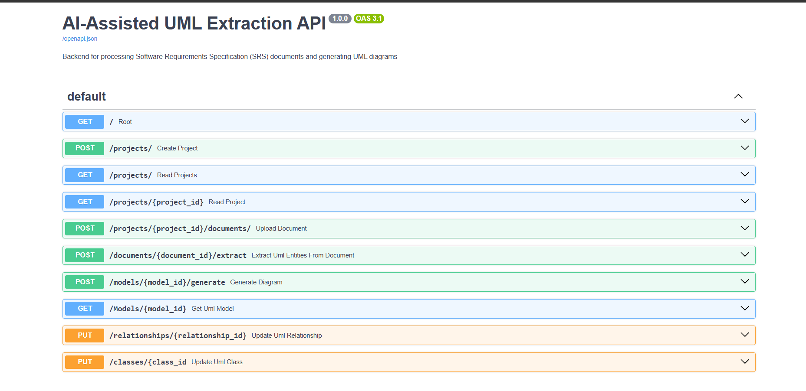
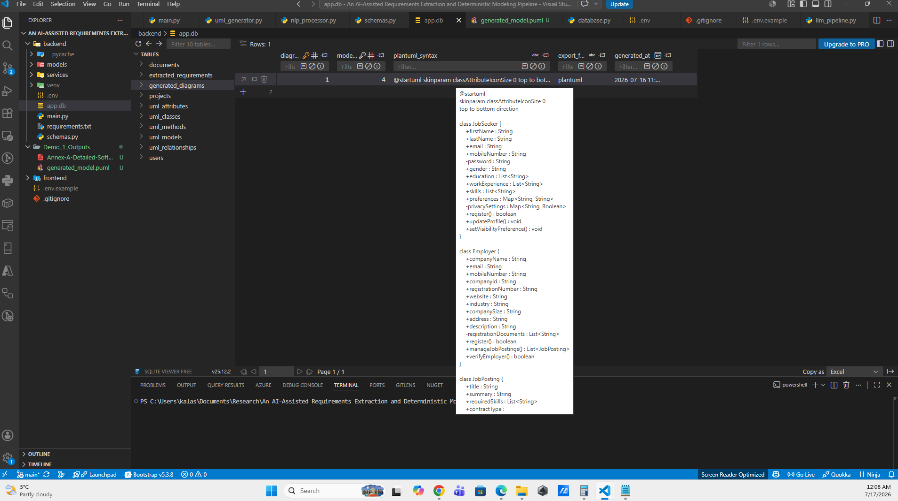
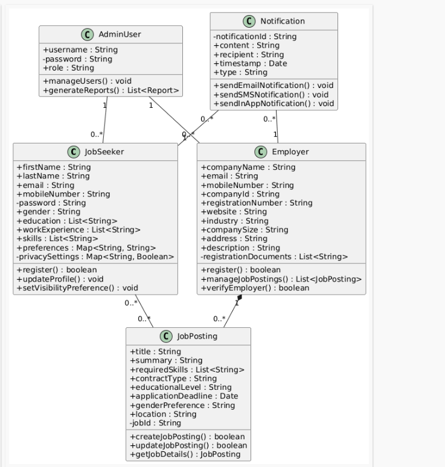

# AI-Assisted Requirements Extraction and Deterministic Modeling Pipeline

**Author:** Lukhanyo Floris Kalashe (2023575000)
**Project:** CSIS6809 Honours Project

## Mid-Year Demo 1 Update
The core backend architecture for this Model-Driven Architecture (MDA) pipeline is now fully operational. The system successfully bridges the gap between unconstrained natural language and deterministic software modeling.

### Proof of Execution
To review the results of the pipeline without needing to execute the API locally, please view the `/Demo_1_Outputs` directory which contains the raw input and intermediate files:
* **Input Document:** `Annex-A-Detailed-Software-Requirements-Specification-SRS.pdf`
* **Compiled Rule Engine Text:** `generated_model.puml`

Below is the visual proof of the system's successful end-to-end execution.

#### 1. RESTful API Documentation (Swagger UI)
This FastAPI backend exposes a fully documented, interactive API. The endpoints manage the entire lifecycle from document ingestion to extraction and diagram generation.


#### 2. Database to PlantUML Compilation
This image demonstrates the FastAPI pipeline successfully fetching the nested entities from the SQLite database and deterministically compiling them into syntactically perfect PlantUML text.


#### 3. Final Rendered Domain Model
This image shows the final rendered diagram generated directly from the pipeline's output. It proves the backend rule engine accurately handled and mapped access modifiers, complex data types, and structural relationship multiplicities.
I copied the producted PlantUML syntax and pasted on "https://www.planttext.com/" to produce this. This won't be needed in the next demos as i would have implemented it within my system for rendering the produced Diagram


---

## System Architecture & Workflow
This FastAPI backend executes the following multi-stage pipeline:

1. **Document Ingestion:** Securely uploads PDFs/TXTs and sanitizes broken Unicode characters.
2. **Intelligent Chunking (`spaCy`):** Slices text using a sliding-window overlap to preserve context without exceeding LLM token limits.
3. **Semantic Extraction (LLM):** Uses an AI API to read chunks and strictly format the output into a deterministic JSON metamodel via Pydantic validation.
4. **Relational Persistence:** Maps the AI's output into a highly structured SQLite database (using fuzzy-matching for relationships to prevent string-mismatch orphans).
5. **Rule Engine:** Deterministically compiles the database records into syntactically perfect PlantUML code.

---

## Local Setup Instructions (Optional)
If you wish to run the FastAPI server and test the Swagger UI locally:

1. **Install Dependencies:**
   ```bash
   pip install fastapi uvicorn sqlalchemy pydantic openai spacy PyPDF2 python-dotenv
   python -m spacy download en_core_web_sm
